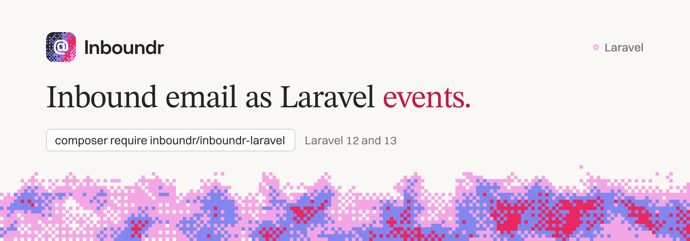

# Inboundr for Laravel

[](https://packagist.org/packages/inboundr/inboundr-laravel)
[](./LICENSE)

Laravel integration for [Inboundr](https://inboundr.net): a webhook route that verifies each delivery and fires an event, and the API client from the container. Built on [inboundr/inboundr](https://github.com/inboundr-net/inboundr-php).

- [Quickstart](https://inboundr.net/docs/quickstart)
- [API reference](https://inboundr.net/docs/api-reference/introduction)

## Install

```bash
composer require inboundr/inboundr-laravel
```

Laravel 12 or 13, PHP 8.2+.

Add your keys to `.env`:

```bash
INBOUNDR_API_KEY=inb_123456789
INBOUNDR_WEBHOOK_SECRET=whsec_123456789
```

The webhook secret is the `whsec_` value returned when you create the endpoint. The API key is only needed for calling the API.

## Receive email

Register the route in `routes/web.php`:

```php
Route::inboundrWebhook('/inbound');
```

Point your Inboundr endpoint at `https://your-app.com/inbound`. Every delivery is verified before anything runs; anything that fails gets a `400`. The route skips CSRF protection, which a webhook can't pass.

Then listen for the event:

```php
use Inboundr\Laravel\Events\InboundEmailReceived;

class HandleInboundEmail
{
    public function handle(InboundEmailReceived $event): void
    {
        $email = $event->email;

        logger()->info("{$email['from']}: {$email['subject']}");
    }
}
```

Laravel discovers listeners in `app/Listeners` automatically. Implement `ShouldQueue` to handle mail on a queue instead of in the request.

`$event->email` has `id`, `threadId`, `from`, `to`, `cc`, `subject`, `text`, `html`, `attachments`, `verdicts` and `receivedAt`.

### Retries

Inboundr retries a delivery until it gets a `2xx`. The route remembers each delivery id for a day and answers repeats with `204` without firing the event again. If a listener throws, the id is forgotten, so the retry is handled.

### Missing body

Some hosts drop the request body. The delivery still carries a signed email id; the route verifies it, fetches the email through the API (this needs `INBOUNDR_API_KEY`) and fires the same event with `$event->bodyWasMissing` set to `true`.

## Call the API

Type-hint the client anywhere the container resolves:

```php
use Inboundr\Inboundr;

public function __construct(private Inboundr $inboundr) {}

$this->inboundr->emails->reply($emailId, ['text' => "Thanks, we're on it."]);
```

Or use the facade:

```php
use Inboundr\Laravel\Facades\Inboundr;

$page = Inboundr::emails()->list(['direction' => 'inbound', 'limit' => 20]);
```

Every method of the [PHP SDK](https://github.com/inboundr-net/inboundr-php#resources) is available.

## Configuration

To change the defaults, publish the config file:

```bash
php artisan vendor:publish --tag=inboundr-config
```

| Key | Default | |
| --- | --- | --- |
| `api_key` | `INBOUNDR_API_KEY` | |
| `base_url` | `https://inboundr.net` | |
| `timeout` | `30` | Seconds. |
| `webhook.secret` | `INBOUNDR_WEBHOOK_SECRET` | |
| `webhook.tolerance` | `300` | Maximum signature age, in seconds. |
| `webhook.dedupe` | `true` | Skip deliveries already handled. |
| `webhook.dedupe_ttl` | `86400` | How long to remember a delivery id, in seconds. |
| `webhook.cache_store` | default store | Cache store for delivery ids. |

## Your own controller

To handle deliveries yourself, use the middleware on your route. It answers `400` to anything unverified and puts the event on the request:

```php
use Inboundr\Laravel\Http\Middleware\VerifyInboundrWebhook;

Route::post('/inbound', InboundController::class)
    ->middleware(VerifyInboundrWebhook::class)
    ->withoutMiddleware(\Inboundr\Laravel\Routes::CSRF_MIDDLEWARE);

// In the controller:
$event = $request->attributes->get(VerifyInboundrWebhook::EVENT);
```

`Route::inboundrWebhook()` is a macro, which static analysis can't see. `\Inboundr\Laravel\Routes::webhook('/inbound')` does the same and is fully typed.

## Contributing

See [CONTRIBUTING.md](./CONTRIBUTING.md).

## License

MIT
